# Winklet: a tiny winking Dynamic Island for Windows

A small notch at the top of your screen. It shows the clock, battery, live activities (music, focus timer, game stats) and notifications. Hover over it to open a dashboard with productivity, health, developer and gaming tools.

Built in **Rust + Slint**, with no browser engine: about 11 MB of memory at rest and no GPU use.

<p align="center">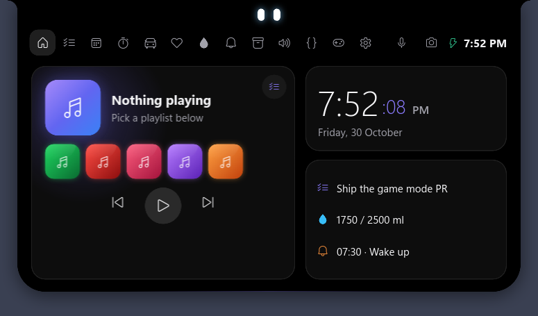</p>

## Contents

[The pill](#the-pill) · [Notifications](#notifications) · [Home](#home) · [To-do and calendar](#to-do-and-calendar) · [Focus](#focus) · [Drive modes](#drive-modes) · [Health](#health) · [Screen time](#screen-time) · [Day summary](#day-summary) · [Water and drinks](#water-and-drinks) · [Alarms](#alarms) · [Shelf](#shelf) · [Send](#send-to-phone-or-pc) · [Clipboard](#clipboard) · [Audio](#audio) · [Developer](#developer) · [Deck](#deck) · [Wallpaper](#wallpaper) · [Game mode](#game-mode) · [Power](#power) · [Settings](#settings) · [Download](#download) · [Build it](#build-it-yourself) · [How it stays light](#how-it-stays-light) · [Project layout](#project-layout)

## Features

### The pill

The resting island: clock, the current focus timer, two glowing eyes and the battery (or charging state). The current gear sits next to the clock when the island is open. A muted mic shows a red icon. After 60 s with no input the eyes doze and the clock dims.

  

* **Live activities.** The pill widens for the track that's playing or a running focus timer.
* **Lively eyes.** Short random moments: they look around, wink, look happy or surprised, show hearts, sip a coffee (always first thing in the morning) or watch a tiny car drive past. They wear headphones and bob along to music and show zzz when you step away. Charging makes them happy, hitting your water goal shows hearts, toggling the mic surprises them. Turn this off with **Lively eyes** to keep blinking only.

  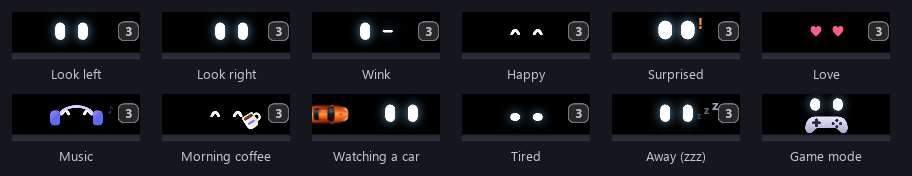
* **Move it.** Right-drag the island anywhere (even with the panel open: it closes and the pill follows the pointer), or use **Settings → Move**: it follows the pointer until you click to drop it. It docks to any screen edge: a notch at the top, flat on the taskbar at the bottom, and standing upright (time, eyes, battery) on the left or right. **Top centre** puts it back, and **Top centre at start** (on by default) does that every launch.
* **Eye colours.** Pick the eyes' colour in **Settings → Look**: Ice, Aqua, Mint, Lime, Sun, Peach, Rose, Lilac, Sky, Ember, or Theme to match the accent.

  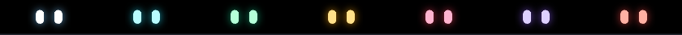
* **Bubble style.** Prefer something smaller than a notch? **Settings → Look → Island style → Bubble** turns the resting island into a floating ball with just the eyes. It bobs gently while you're at the PC and settles when you step away, grows a little under the pointer (and a bit more for eye events, so the headphones, zzz, coffee or car always fit inside), shows a running focus timer as a ring around the eyes, and opens into the full panel just like the notch (rounded all round, a few pixels off the screen edge).

  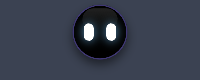 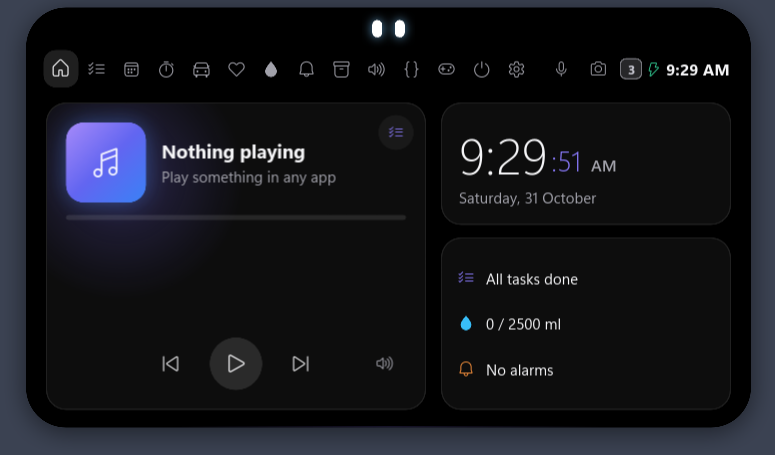
* **Car show.** When the island opens, a car drives in underneath, drifts a donut with tyre smoke and skid marks, then speeds off. Pick JDM, Muscle, German or F1 in **Settings → Look**, or turn it off.

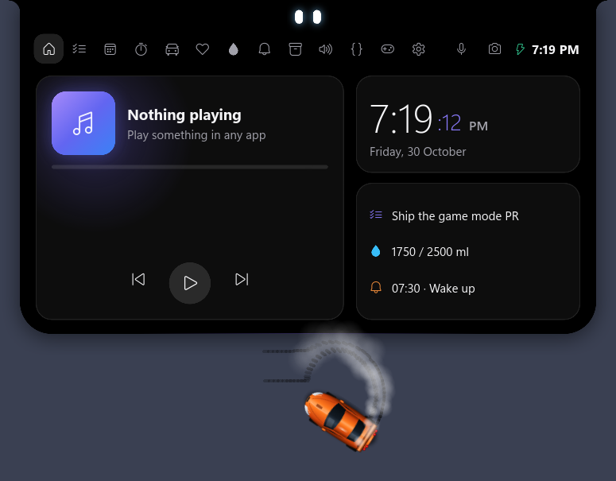

### Notifications

Short peeks drop down from the pill: charger plugged in or out, track change, water reminder (with a one-click **+cup**), alarm, task reminder, focus or break finished, stand-up reminder (with **Done**, **Snooze** and a 60-second **Guide me** stretch), game started or closed, and the evening day summary.

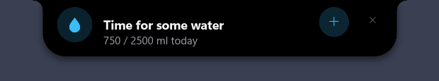 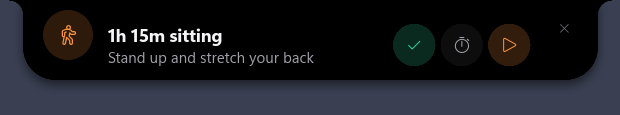

### Home

A media card with previous, play/pause and next for **any** player (Spotify, browsers, Apple Music and more, through Windows media controls), a big clock, your next task, today's water and your next alarm.

**Playlists.** The list button on the media card flips it to your saved playlists: colourful covers per service (Spotify, YouTube Music, YouTube, Apple Music, Anghami, SoundCloud, Deezer, TIDAL, Amazon Music) in a scrolling grid. Paste a link to add one (`Gym https://open.spotify.com/playlist/…` names it), click a cover to play it (Spotify links open straight in the Spotify app), drag a cover onto another spot to reorder them, and remove one with two clicks on its ×. When nothing is playing, your latest playlists sit right on the card, one click away. Nothing is fetched from the internet; the service is read from the link.

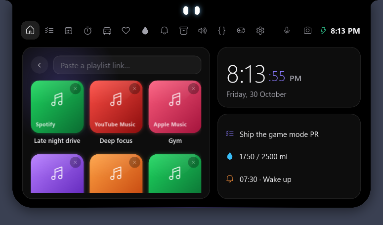

### To-do and calendar

Add tasks in plain text: `Call mom @18:30` sets a reminder, and `Deploy @2026-11-02 09:00` or `Gym @tomorrow 7am` also work. Tick tasks off, delete them, or clear all done tasks. The calendar marks days with open tasks; click a day to see and add its tasks.

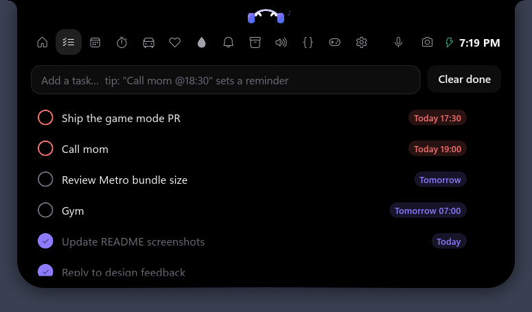 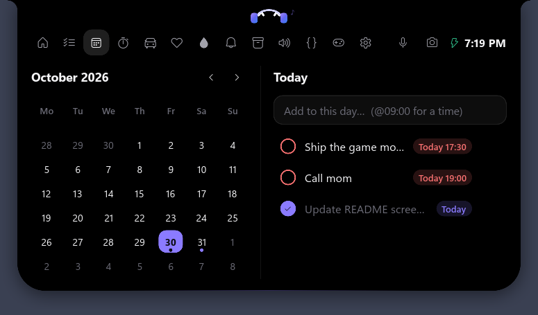

### Focus

A Pomodoro timer with adjustable focus and break lengths. The break starts on its own, and dots count today's sessions.

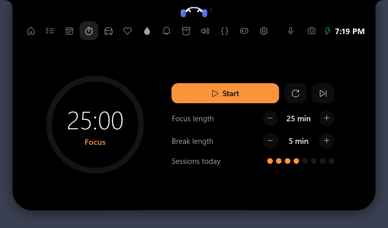

### Drive modes

A 6-speed H-pattern gear shifter (the car tab). Drag the knob or click a gear; **Ctrl+Alt+PgUp / PgDn** shifts up or down and **R** goes back to your last gear. Each gear decides what gets through:

| Gear | What it does |
|---|---|
| **N** | Away: alarms only |
| **1 / 2** | Rest / cruise: every reminder on |
| **3** | Normal |
| **4** | Busy: no music, charger or eye-rest popups |
| **5** | Focus: starts the focus timer; water and stand-up wait |
| **6** | Redline: mic muted, alarms only |

Held reminders show once you shift down. Shifting can also set the Windows power mode (N–2 best efficiency, 3–4 balanced, 5–6 best performance). The pill shows the gear, and the tab charts today's active time in each gear.

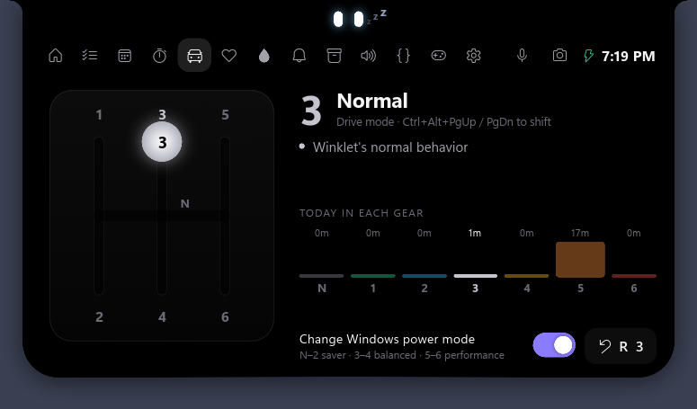

### Health

Winklet tracks how long you've been sitting by checking only the time since your last mouse or keyboard input (or controller, while gaming), never what you type. Being away 3 minutes or more, locking the PC or sleep counts as a break.

Stand-up reminders wait for a pause in your typing, hold off during calls, fullscreen apps, games and focus sessions, and escalate from 50 to 75 to 90 minutes. Snoozing shortens each time and softens the suggestion, and a nearly-due water reminder is folded in. **Health → Now** shows your current sitting time, active time today, breaks, longest sit, an hour-by-hour chart and 7 days. There's also an optional 20-20-20 eye-rest reminder and working hours.

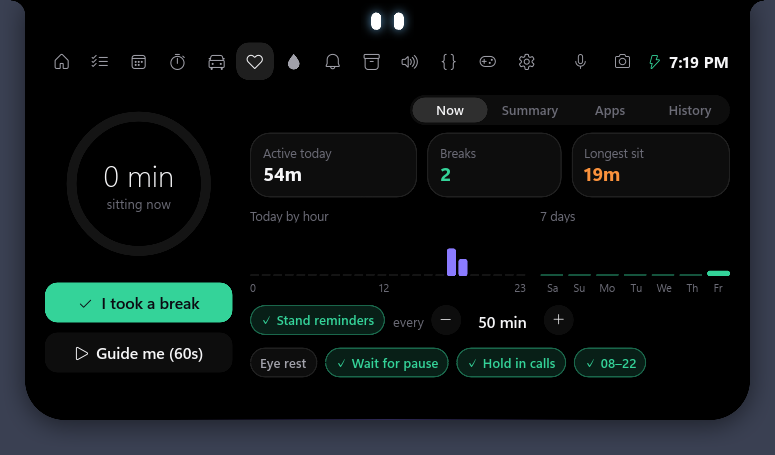

**Health → History** is a GitHub-style heatmap of 30 weeks. **PC on** is rebuilt from Windows' own boot, sleep, wake and shutdown events, so it shows months of history right away; **You active** is the keyboard and mouse time Winklet tracked. Hover a square for the exact time. It also shows totals, daily average, streak and busiest day.

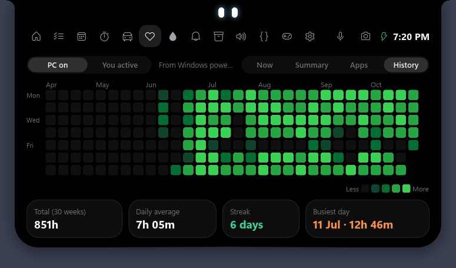

### Screen time

**Health → Apps** lists every app you used on a day (◀ ▶ goes back up to 60 days, or click the day for a calendar; days you were active have a dot) with its icon and total time. Click an app to see each time you used it ("9:02 – 10:48 AM · 1h 46m") on a 24-hour timeline. Only the program is recorded, never window titles or what you type.

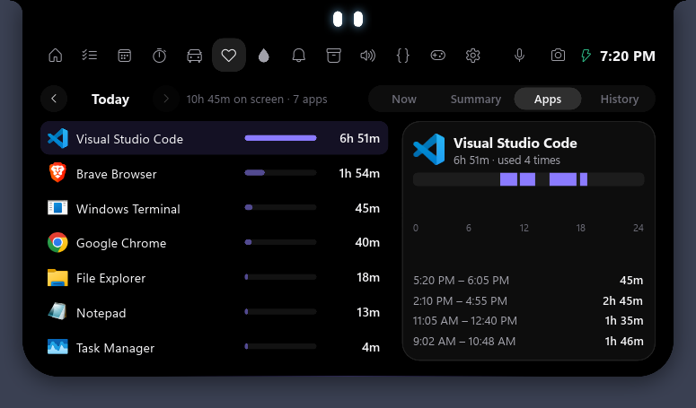

### Day summary

**Health → Summary** shows your day: active time, focus sessions, tasks done, breaks, longest sit, water, gaming and the three most used apps. At 18:00 (adjustable, or off) a peek sums it up, with a button that opens this view.

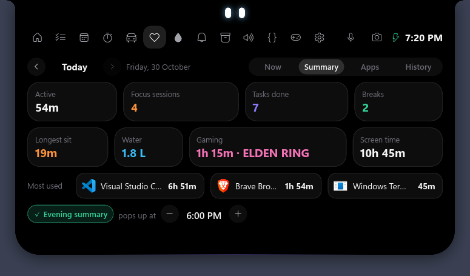

### Water and drinks

Not just water: tap **Water, Tea, Green tea, Coffee, Espresso, Iced latte, Spanish latte, Matcha latte, Juice, Milk, Sparkling** or **Hot chocolate**, then pick how much from cups drawn out for you: a shot (40 ml), tea glass (150), cup (250), big mug (350), tall glass (400), bottle (500) or big bottle (1 L), or any other amount. The size you had last time is marked, so it adapts to your own cups. Each drink has its own colour, and the bottle fills in layers of what you drank today, with moving waves in the colour of the last one and bubbles rising through it. Drinks you had today light up in their colour.

* **Your own drinks.** **New drink** asks for a name (Cortado, Mocha, Lemonade…) and one of 12 colours; you pick the size when you log it. Right-click any drink to rename it, recolour it or remove it.
* Every drink counts towards the daily goal. **Undo** takes back the last one, and the 7-day chart shows how close each day got.
* Reminders come every N minutes between 08:00 and 22:00, with a one-click **+cup** of water.

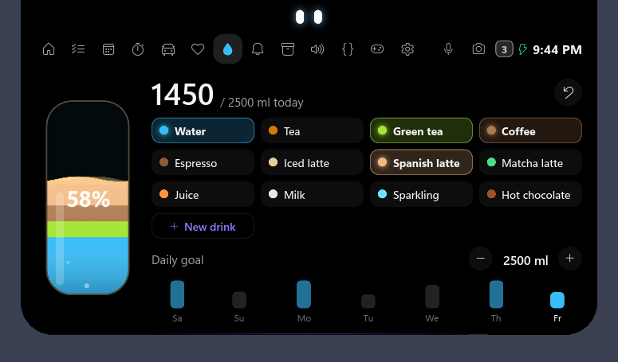 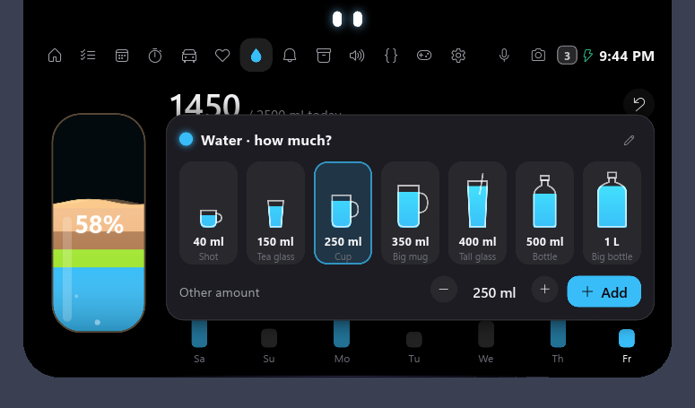
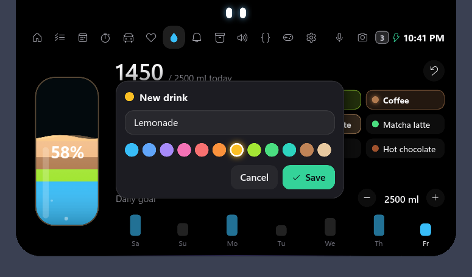

### Alarms

`07:30 Wake up` creates a daily alarm that plays the Windows alarm sound. Switch each alarm on or off.

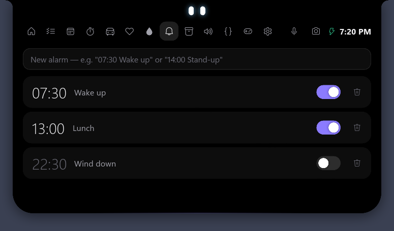

### Shelf

Drag files or folders onto the island, or use the **Files** and **Folders** buttons. Items are saved as shortcuts; nothing is moved or copied. **Click** opens an item, **right-click** copies its path and **middle-click** shows it in Explorer.

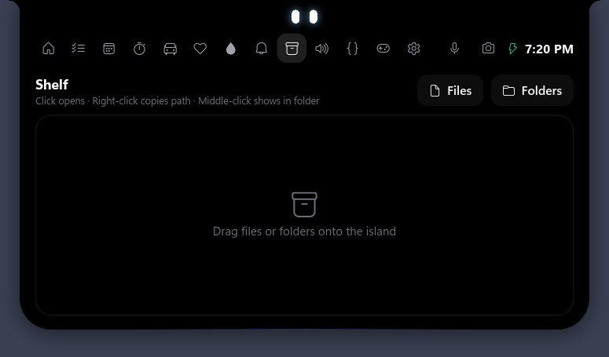

### Send to phone or PC

**Shelf → Send** moves files between this PC and a phone (or another PC) on the same Wi-Fi, with no app or account on the other side.

* **Fill the basket.** Drag files or folders onto the island, one at a time or many at once, or use **Files** / **Folder**. Forgot one? Drop it in any time, even while sharing: it shows up on the phone by itself. Folders are sent as a .zip.
* **Show QR code.** Scan it with the phone camera, or open the link on any device on the same Wi-Fi. The page lists every file with **Get** and **Download all**.
* **Phone to PC.** The same page has **Send to the PC**: pick photos or files on the phone and they land in your Downloads folder, with a notification on the island. Nothing to send? **Receive from phone** opens the page for that alone.
* **Safe by default.** Each link has a long random secret and closes after 30 minutes or when you press **Stop**. A device that keeps guessing wrong links gets blocked, file names from the phone are cleaned up, and received files are marked as downloaded so Windows warns before running them. The first time, Windows Firewall may ask to let Winklet receive connections: allow it on private networks.

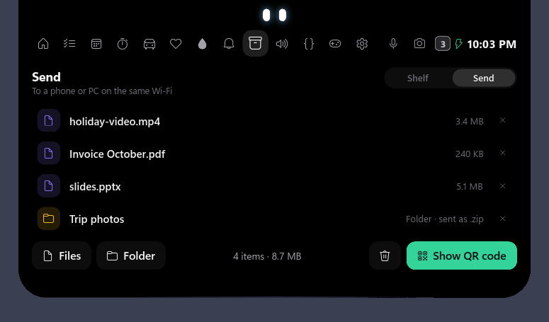 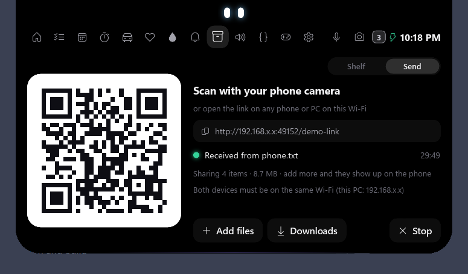

### Clipboard

Everything you copy, kept for you: text, links, colour codes, pictures and copied files. **Ctrl+Alt+V** opens it from anywhere.

* **Find it again.** The list on the left has a search bar and **All / Text / Links / Images / Files** filters. Pictures show a thumbnail, colour codes show the colour, and each item says when you copied it.
* **See all of it.** Pick an item and the preview on the right shows it in full: text in a scrolling viewer with line numbers, pictures fitted to the panel, copied files you can click to open, and a swatch for colour codes.
* **Find inside it.** The preview has its own find bar: every match is highlighted, it shows "3 / 12", and the arrows (or Enter) jump from one match to the next.
* **Use it.** **Copy** puts it back on the clipboard; a double-click in the list pastes it straight into the app you were using. **Pin** keeps an item for good, even after **Clear**.
* **Private by default.** It keeps the newest 300 items plus anything pinned, on your PC only. Copies that password managers mark as private are never saved, and the pause button stops saving for as long as you like.

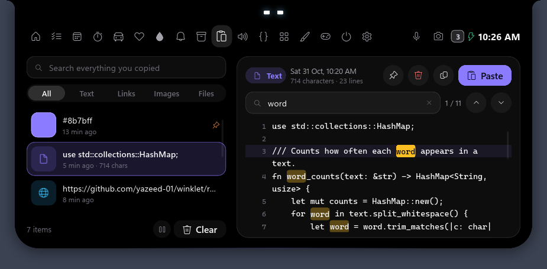

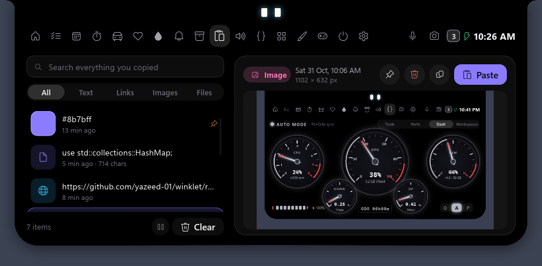

### Audio

Volume for **each app** (one slider per app even when it has many audio sessions), mute per app, master volume, and **microphone on/off** with a live **test meter**. The mic shows its full name; click it to pick another microphone, which becomes the Windows default for apps and calls.

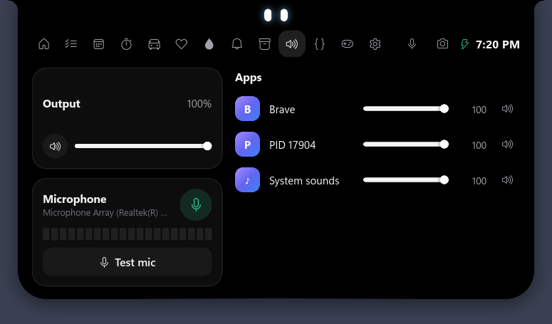

### Developer

* **Tools:** live CPU and RAM, uptime and local IP. **4 Terminals** opens Windows Terminal as a 2×2 grid in your workspace folder. One-click buttons copy a UUID, a Unix timestamp, an ISO date or a strong password, and open Terminal, Task Manager, localhost:3000, startup apps or the hosts file. **Projects** and **Downloads** rows show the folder they point to: click to open it (it asks where it is the first time if it can't find it), and the pencil changes it.
* **Ports:** every listening TCP port with the app that owns it, well-known dev ports (8081 Metro, 19000 Expo, 3000, 5173 Vite, 4200, 5432 Postgres…) first. **Kill** needs two clicks within 3 s. Windows services are hidden behind **Show system**.
* **Dash:** a racing instrument cluster: a CPU tachometer, a big GPU dial (load plus VRAM), download and upload dials, RAM as a temperature gauge, battery as a fuel gauge and today's screen time as the odometer. On Lenovo laptops it follows **Fn+Q** (Quiet blue, Auto gray, Performance red) without admin rights.
* **Workspaces:** named sets of apps, files, folders and links that open together with one ▶ (for example *Coding*: VS Code, Terminal, the repo folder and localhost). Add apps that are open right now with one click, browse for programs or files, or paste a link or folder path.
* **Capture:** the camera button or **Ctrl+Alt+S** takes a full-screen screenshot, saves it to `Pictures\Screenshots` and copies it; the island hides itself first. Right-click the camera to snip an area.

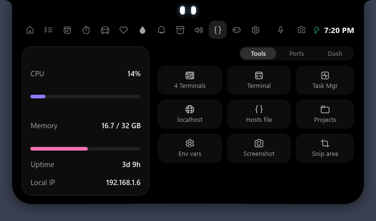 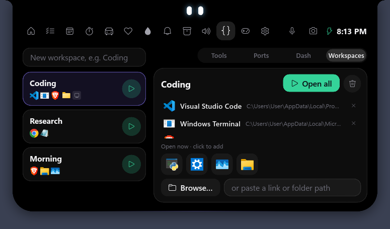
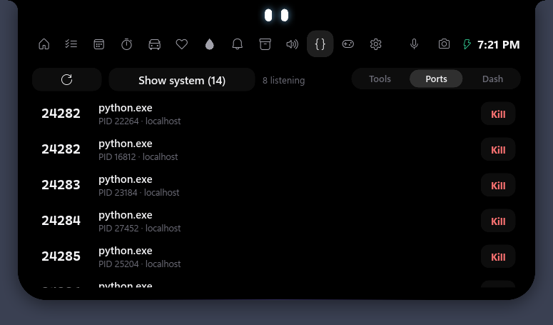 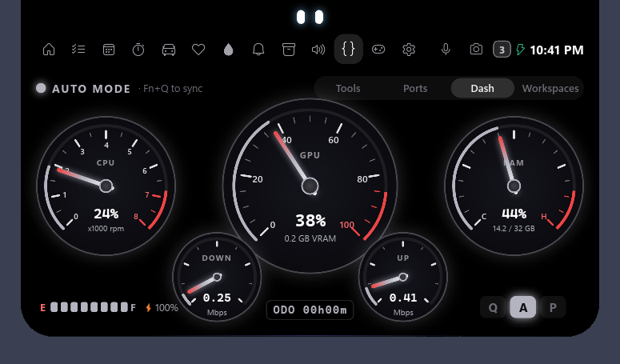

### Deck

Your own Stream Deck on the island: a grid of 8 × 3 keys, on up to six pages. Each key does one thing with one click:

| Key | What it does |
|---|---|
| **Open** | An app, file, folder or website (`https://…`, `ms-settings:`, …) |
| **Multi** | Several at once: apps, files, folders, links, or `> a command`, one per line. A whole setup with one press |
| **Command** | Runs a command line, hidden or in a console that stays open so you can read the output |
| **Script** | Runs a whole PowerShell or Batch script you write in the key, hidden or in a console that stays open |
| **Hotkey** | Presses a key combination in the app you were using: `ctrl+shift+esc`, `win+d`, `alt+f4`, `f5` … |
| **Text** | Types text for you (an email address, a reply you send often), optionally pressing Enter after |
| **Action** | Play/pause, next, previous, mute, volume up/down, mic on/off, screenshot, lock, sleep, focus timer, game mode |

* **Make it yours.** Every key has a title, one of 12 colours, and either the app's own icon or one of 32 glyphs. The editor shows a live preview of the key as you change it, and **App or file** / **Folder** fill in the path (and name and icon) for you.
* **Right-click a key** to change it, or press **Edit**: then a click edits a key, you can drag keys to new spots, and add or remove pages. Keys spring when you press them and flash when they fire.
* New installs start with a few useful keys (Explorer, Terminal, Calculator, Task Manager, Settings, Show desktop, media keys, mic, screenshot, focus and lock) to change or remove.

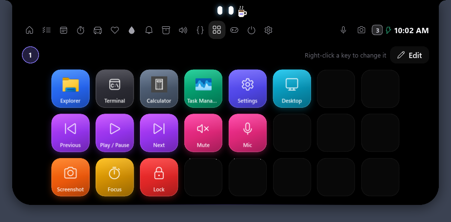

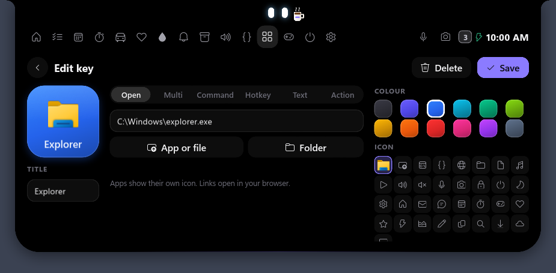

### Wallpaper

Change your desktop picture without opening Settings.

* **Now and next.** The left shows the wallpaper on your screen now; the right is a gallery of Windows' own wallpapers. Click any picture to put it on the desktop: it changes right away.
* **Carousel or grid.** The gallery opens as a 3D-style carousel: the front picture stands tall on a glossy floor with its reflection while the others step back and dim on either side. Scroll or use the arrows to slide through, click a side picture to bring it forward and the front one to set it. The switch at the top right swaps to a plain grid, and the view you pick last sticks.
* **Your folders.** **+** adds any folder of pictures (JPG, PNG, BMP, WebP, subfolders too) as its own tab. **Open** shows it in Explorer, and right-clicking a folder tab removes it (the pictures stay where they are).
* **Fill, Fit, Stretch, Centre or Span** sets how the picture covers the screen.
* **Shuffle** picks a random picture from the folder, and **Change every** (15 minutes to a day) does it for you.
* Thumbnails come from Explorer's own thumbnail cache on a background thread, so even folders of big photos load smoothly.

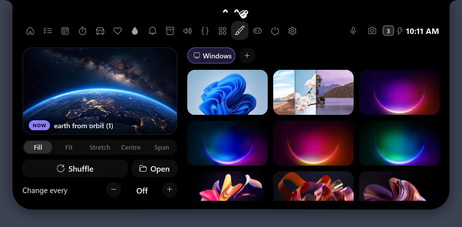

### Game mode

Turn it on in the **Game** tab, in Settings or with **Ctrl+Alt+G**, or let it switch on by itself when a game starts.

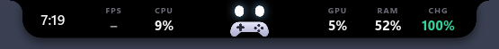

* **Stats pill.** The pill widens to time · FPS · CPU · GPU · RAM · battery, and the eyes hold a controller and tap its buttons while you play. It stays on screen over the game in borderless fullscreen, and steps aside for exclusive fullscreen so the game keeps it.
* **Game tab first.** While game mode is on, opening the island goes straight to the Game tab; turn it off and you're back where you were.
* **Live view.** The game in front with its session and today's play time, a big FPS number with a graph, and rings for CPU, GPU, RAM, VRAM, battery and controller battery.
* **Library.** Every game with total hours, this week, sessions and last played, plus a ▶ launch button (Steam and Epic games launch through their launcher). **Scan** finds games installed with Steam, Epic and GOG before you've played them, **Add game** picks one by hand, and the search box filters the list.
* **Finds games by itself:** by their folder (Steam, Epic, Xbox, Riot, GOG, EA, Ubisoft), from Windows' own game list, or because they run fullscreen. Steam games get their real names. **Not a game** fixes a wrong guess.
* **Plays nice.** Water and stand-up reminders wait while you play, a break nudge comes after 2 hours, and the Windows power mode switches to Best performance (each optional). Controller play counts as being active.
* **FPS** comes from RivaTuner (MSI Afterburner) when it's running, or from Windows' own present events, which need a one-time **Allow FPS** approval and a sign-out. Vulkan and OpenGL games may only show FPS through RivaTuner, and games in old exclusive fullscreen can't be drawn over.

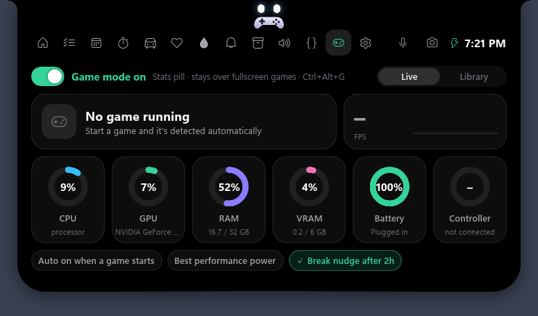 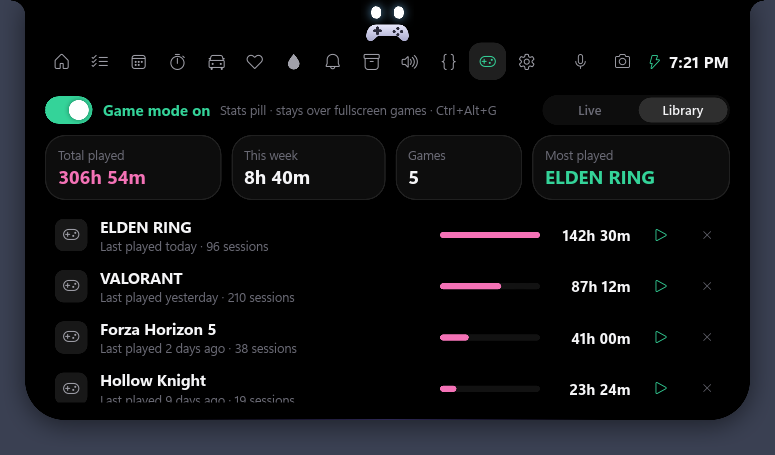

### Power

Lock, sleep, restart, sign out or shut down, right now or later. Pick an action, then when: **Now**, **5 min**, **15 min**, **30 min**, **1 h**, **2 h**, or any delay in 5-minute steps with − and +.

* **Change your mind any time.** A planned action shows the time it will happen and a live countdown, with **Cancel** next to it. The Power tab icon glows orange while something is waiting.
* **A minute's warning.** A minute before, a notification drops down from the pill ("Shutting down in a minute") with its own **Cancel**, so you can stop it without opening the island.
* **No accidents.** Restart, sign out and shut down *right now* take a second click. Restart and shut down never force apps closed, so anything with unsaved work still gets to ask. If the PC was asleep when the time came, the action is skipped instead of happening the moment it wakes up.

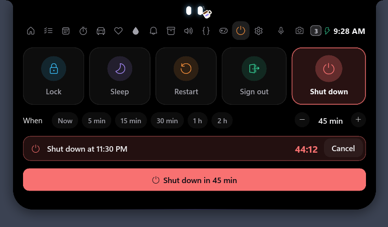

### Settings

Settings has two views.

**General:** launch at startup, 12- or 24-hour clock, hide during fullscreen games, videos and presentations, game mode, water reminders and their interval, where the island sits (**Move**, **Top centre**, **Top centre at start**), **Your data** (open the folder it's saved in, or **Reset all** with a second click to confirm), and **Quit Winklet**. The tray icon has Open and Quit too.

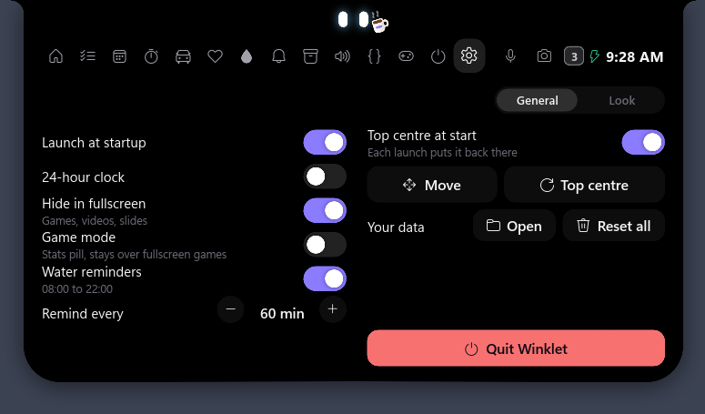

**Look:** how the island looks and moves.

* **Island style.** **Notch** (the original, against the screen edge) or **Bubble** (a floating ball with just the eyes, see [The pill](#the-pill)).
* **Size.** One slider from 80% to 140% makes the open panel and the resting pill bigger or smaller together. It applies when you let go of the slider, on top of the Windows display scale.
* **Transparency.** From solid to 60% see-through. Only the island's background fades: text, icons and cards stay sharp, so it reads like frosted glass over your wallpaper.
* **Eye colour.** Eleven colours for the eyes: **Ice** (the original white), **Aqua**, **Mint**, **Lime**, **Sun**, **Peach**, **Rose**, **Lilac**, **Sky**, **Ember**, and **Theme**, which follows the theme's accent. The eyes smile when you pick one so you see it right away.
* **Lively eyes**, **Car show** with its car model and **Test drive**, and the **Theme** picker.

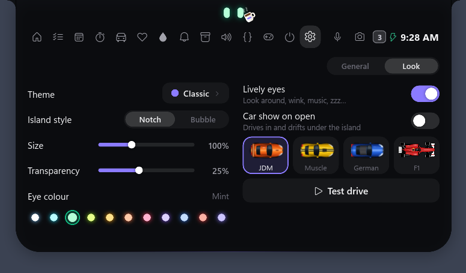

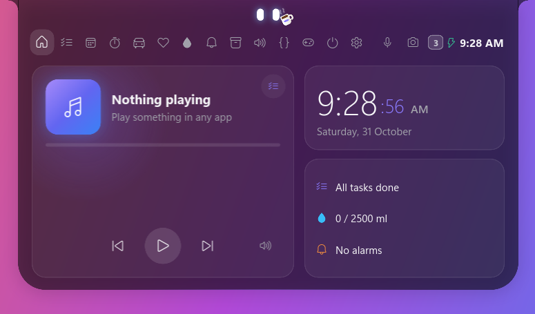

**Theme** picks the colours: **Classic** (the original look, and the default), **Racing Green**, **Burgundy Sage**, **Acid Lime**, **Orchid Sunset**, **Chrome Laser**, **Coral Steel**, **Aurora** and **Graphite**. The island stays dark in every theme; each one tints it and changes the text and accent colours, and the change applies right away. Next to it, **Dark / Light** switches the open panel to a light mode in soft, warm paper tones with gentle contrast, easy on the eyes and never glaring white. The pill stays dark so the eyes still glow.

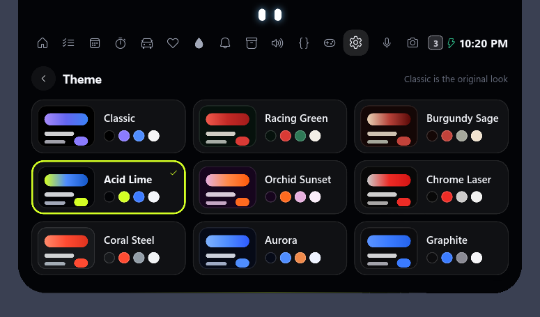

### Hotkeys

| Keys | Action |
|---|---|
| **Ctrl+Alt+Space** | Open or close the island |
| **Ctrl+Alt+S** | Screenshot |
| **Ctrl+Alt+M** | Mic on/off |
| **Ctrl+Alt+PgUp / PgDn** | Shift gear up / down |
| **Ctrl+Alt+G** | Game mode on/off |
| **Ctrl+Alt+V** | Clipboard history |

Hover any icon button for a short label explaining what it does; it shows just above what you point at, so the cursor never covers it. Switching tabs slides the new page in from the side you're moving to, with a small spring and zoom.

## Download

Grab `winklet.exe` from the [latest release](https://github.com/yazeed-01/winklet/releases/latest) and run it: it's a single file with nothing to install (Windows 10/11, x64). Turn on **Launch at startup** in Settings to keep it around. The exe isn't code-signed yet, so SmartScreen may ask once: choose **More info → Run anyway**.

## Build it yourself


```powershell
cargo run --profile fast                               # try it (quick optimised build)
cargo build --release                                  # the exe you ship
powershell -ExecutionPolicy Bypass -File install.ps1   # install to %LOCALAPPDATA%\Winklet + start with Windows
```

You can also turn on **Launch at startup** in Settings. It writes `HKCU\...\CurrentVersion\Run\Winklet`, the same mechanism other tray apps use, so no admin rights are needed.

Your data stays on your PC in `%APPDATA%\Winklet`: `data.json` for tasks, settings, drinks, health and games, and `screen.json` for screen time, `clips.json` and the `clips` folder for the clipboard history. **Settings → Your data** opens that folder or wipes it. There are no accounts and nothing goes online: only **Send** talks to the network, and only to devices on your Wi-Fi while a link is open.

## How it stays light

Measured on this machine (1920×1080 at 125%, Intel UHD + RTX 3060 laptop, release build):

| | CPU (of one core) | Private memory | Working set | GPU |
|---|---|---|---|---|
| Resting pill | 0–0.5% | about 11 MB | about 40 MB | none |
| Panel open (most tabs) | 0–1% | about 20 MB | about 52 MB | none |
| Health or Game tab open | under 5% | about 37 MB | about 80 MB | none |

* **Idle rendering: 0 frames per second.** Slint only redraws when a property changes. The clock updates once a minute, and the eye blink costs a few frames every 6 s. In game mode the pill updates every 2 s. In Bubble style the ball does a short hop every 6 s while you're active.
* **No GPU at all.** Winklet draws with Skia on the CPU. For a window this small that is cheaper than a GPU renderer: switching from FemtoVG on OpenGL cut memory from about 100 MB to about 11 MB at rest (opening the panel used to peak at over 400 MB in the OpenGL driver), made animations about three times cheaper, and never wakes the graphics card.
* **No leaks.** A soak test that switches tabs and opens and closes the island hundreds of times (`WINKLET_DEMO_CYCLE`) levels off instead of growing.
* **Executable: about 33 MB.** It has no runtime dependencies and nothing to install.

The design choices behind these numbers:

1. **No web view.** Electron or Tauri would load a whole browser engine (about 80–200 MB). Winklet uses Slint, a native, declarative UI toolkit that compiles `.slint` files to Rust at build time.
2. **The window hugs the pill.** When the island is collapsed, the window is only 340×44 px (444×44 in game mode, 64×60 as a bubble), so it never blocks clicks on the apps underneath. It grows just before the expand animation starts and shrinks just after the collapse animation ends.
3. **Change-only updates.** The heartbeat only *sets* a UI property when the value actually changed, and live views (Developer, Health, Audio) refresh just the numbers that move, because each change can trigger a redraw.
4. **Animations end.** Nothing animates forever: the water waves play for a few seconds when you open the tab or log a drink, eye moods last a few seconds, and the bubble rests when you step away.
5. **Background work is cheap.** Media info comes from a small thread that polls the Windows media session every 2 s. Screen time reads only which program is in front, every 2 s. The clipboard watcher only compares a counter Windows keeps. CPU, RAM and GPU sampling run only while the Developer tab is open or game mode is on, and wallpaper thumbnails come from Explorer's cache on a worker thread.
6. **Steps aside in fullscreen.** `SHQueryUserNotificationState` detects games, videos and presentations, and the island hides while they run (unless game mode is on).
7. **Release profile.** Thin LTO, `panic=abort` and `strip`; Slint is compiled without accessibility or Qt.

## Project layout

```
ui/
  app.slint          window, island shape, morph animations, pill / peek / expanded views, eyes, tray
  bridge.slint       the `Bridge` global: every property and callback shared with Rust
  pages.slint        re-exports the dashboard tabs from ui/pages/
  pages/             one file per tab (home, todo, calendar, focus, gear, health*, water,
                     alarms, shelf, send, clipboard, audio, dev*, deck, wallpaper,
                     game, power, settings)
  widgets.slint      buttons, toggle, rings, gauges, chips, app icon, ...
  theme.slint        colors, fonts, easing curves, Segoe Fluent icon code points
src/
  main.rs            startup, the App state, hotkeys, demo switches
  app/               one `impl App` per feature: heartbeat, eyes, car, drag, focus, gear,
                     wellbeing, history, screen (screen time), summary, game, planner, ...
  callbacks/         wires each Bridge callback to the app, one file per feature
  store.rs           JSON persistence (data.json, screen.json) + the "@18:30" task parser
  sys.rs             Win32: window placement, battery, idle, CPU/RAM, clipboard, autostart, hotkeys
  fg.rs              the app in front: name, icon, fullscreen, game detection
  fps.rs, pad.rs     game FPS (RTSS / ETW) and XInput controllers
  gpu.rs, gpu_info.rs  GPU load and VRAM (performance counters), GPU name (DXGI)
  media.rs, audio.rs, ports.rs, uptime.rs, lenovo.rs, capture.rs
  clip.rs            clipboard watcher, reading and writing text, pictures and files
  keys.rs            hotkeys, typed text and media keys for the Deck (SendInput)
  wall.rs            desktop wallpaper (IDesktopWallpaper) and shell thumbnails
docs/screenshots/    the pictures in this README
```

### Adding a feature

1. Add the properties and callbacks to `Bridge` in `ui/bridge.slint`.
2. Draw them in a page under `ui/pages/` and, for a new tab, add a `TabButton` in the `Expanded` component of `app.slint` (and its spot in `TabOrder`).
3. Put the logic in a new `src/app/<feature>.rs` with a `refresh_*()` function, and wire the callbacks in `src/callbacks/<feature>.rs`.
4. If it needs to persist, add a field to `Data` or `Settings` in `store.rs`. Use `#[serde(default)]` so old save files still load.

### Debug helpers

```powershell
$env:WINKLET_DEMO_TAB=4; cargo run --profile fast # open on a tab and stay open (screenshots)
$env:WINKLET_DEMO_VIEW=2                          # with DEMO_TAB: sub-view (Health 0-3, Developer 0-2, Game 0-1, Settings 0-2)
$env:WINKLET_DEMO_GAME=1                          # start in game mode
$env:WINKLET_DEMO_DASH=3                          # Developer > Dash in a Lenovo mode (1-3)
$env:WINKLET_DEMO_PEEK=1                          # show a sample notification
$env:WINKLET_DEMO_STAND=75                        # stand-up reminder after 75 minutes
$env:WINKLET_DEMO_GUIDE=1                         # the 60-second stretch guide
$env:WINKLET_DEMO_MOOD=7                          # hold an eye mood (7 = music)
$env:WINKLET_DEMO_NO_MEDIA=1                      # ignore whatever is playing
$env:WINKLET_DEMO_PLAYLISTS=1                     # with DEMO_TAB=0: the playlist grid
$env:WINKLET_DEMO_VOLUME=1                        # with DEMO_TAB=0: the volume slider on the media card
$env:WINKLET_DEMO_POWER=1                         # with DEMO_TAB=13: a planned shutdown (shown only, nothing is planned)
$env:WINKLET_DEMO_DECK_EDIT=0                     # with DEMO_TAB=14: the Deck key editor for slot 0 (DECK_EDITING=1: edit mode)
$env:WINKLET_DEMO_CLIP_FIND=word                  # with DEMO_TAB=16: find in the clipboard preview (CLIP_SEL=id picks the item)
$env:WINKLET_DEMO_CYCLE=400                       # with DEMO_TAB: walk every tab and open/close the island (memory soak test)
$env:WINKLET_TRACE=1                              # log hover / idle / media events to stdout
$env:SLINT_DEBUG_PERFORMANCE="refresh_lazy,console"   # print frames per second
cargo test probe -- --ignored --nocapture         # what this PC reports: app in front, GPU, controller, FPS access
```

The screenshots were taken with these switches and a sample data folder (`APPDATA` pointed elsewhere) for tasks, alarms, water, screen time and games. Audio, ports, history and system stats are live from the PC.

## Ideas for next steps

* **Volume and brightness overlays** using `IAudioEndpointVolumeCallback` (event-driven, no polling).
* **Caps Lock and input-language toasts** (`WM_INPUTLANGCHANGE`, `GetKeyState` in the heartbeat).
* **Album art** with `TryGetMediaPropertiesAsync().Thumbnail()` decoded into a `slint::Image`.
* **Synced lyrics** from LRCLIB, highlighted by media position.
* **Clipboard history**: `AddClipboardFormatListener`, last 20 entries, click to re-copy.
* **Shelf drag-out** with `DoDragDrop`.
* **Hide from screen sharing** with `SetWindowDisplayAffinity(WDA_EXCLUDEFROMCAPTURE)`.
* **Git / CI status** and **Claude Code / Codex agent status** through a local named pipe.
* **GPU temperature** (NVML / ADLX) on the Game tab.
* **Google or Outlook calendar sync** for the Calendar tab.

## License

[MIT](LICENSE) © Yazeed Migdadi

## Credits

* The F1 car is from [2D Race Cars](https://opengameart.org/content/2d-race-cars) by looneybits (CC0).
* The JDM, Muscle and German cars are original vector art made for Winklet (`assets/cars/*.svg`), with no manufacturer logos.
